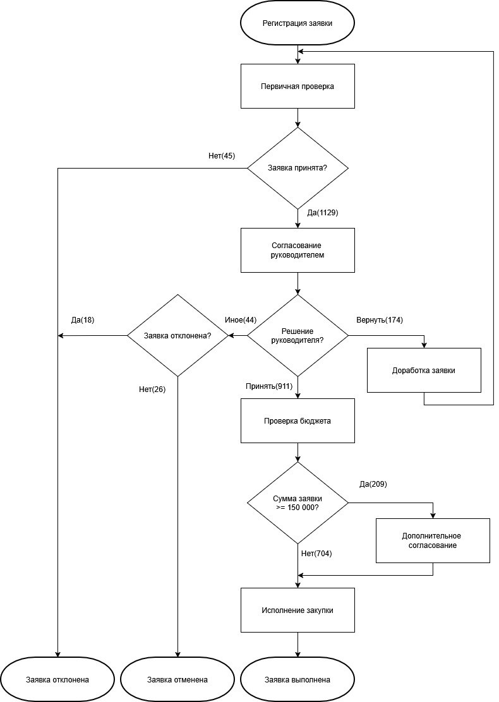

# Восстановление процесса закупки по журналу событий

Практика 2: Process Discovery. По журналу `students.csv` (1000 экземпляров, 6508 событий, одна версия шаблона) восстановлена модель нормального поведения процесса обработки заявок на закупку.
## Схема

## Метод

1. События сгруппированы по `ProcessInstanceId` и отсортированы по числовому `EventIndex`.
2. Повторы активностей не удалялись (у них разные `TaskId`).
3. Подсчитаны полные маршруты (варианты), пары непосредственно следующих действий, значения `Result` по активностям.
4. Проверена связь `Amount` с наличием «Дополнительного согласования».
5. Инструменты: Python 3, pandas, Graphviz (схема). ИИ для получения выводов не применялся, все числа воспроизводятся скриптом.

Проверки согласованности: сумма вариантов = 1000; исходы 911 + 63 + 26 = 1000; «Доработок» 138 + 2·18 = 174.

## Результаты

**Активности (10).** Старт — «Регистрация заявки» (автоматически). Человеческие задания и роли:

| Активность | Роль |
|---|---|
| Первичная проверка | specialist |
| Согласование руководителем | manager |
| Доработка заявки | requester |
| Проверка бюджета | finance |
| Дополнительное согласование | director |
| Исполнение закупки | procurement |

**Окончания (3).** «Заявка выполнена» — 911 (91,1%), «Заявка отклонена» — 63 (6,3%), «Заявка отменена» — 26 (2,6%).

**Основной маршрут** (V1, 56,7%): Регистрация заявки → Первичная проверка → Согласование руководителем → Проверка бюджета → Исполнение закупки → Заявка выполнена.

**Обязательные и необязательные этапы:**
- «Регистрация» и «Первичная проверка» есть в 100% случаев.
- «Согласование руководителем» есть в 95,5% (955 из 1000), нет только у 45 заявок, отклонённых на первичной проверке.
- «Проверка бюджета» и «Исполнение закупки» есть в 91,1% случаев; для заявок, не отклонённых и не отменённых, — в 100%.
- «Доработка заявки» есть в 15,6% случаев (156).
- «Дополнительное согласование» есть в 22,9% выполненных заявок (209 из 911).

**Развилки** (Result: число событий):
- После «Первичной проверки»: accept 1129, reject 45 (reject только на первом проходе).
- После «Согласования руководителем»: accept 911, return 174, reject 18, cancel 26.
- После «Проверки бюджета»: всегда accept (911); далее «Дополнительное согласование» (209) либо сразу «Исполнение» (702). Выбор определяется суммой: у всех 209 заявок с доп. согласованием `Amount` ≥ 150 614,59, у всех 702 без него ≤ 149 743,41. Правило «сумма ≥ 150 000» разделяет выполненные заявки без ошибок.

**Возвраты.** Единственный цикл: Согласование → Доработка → Первичная проверка → Согласование. Один возврат — 138 случаев (117 + 21), два — 18, три и более не наблюдались. Возврат возможен только после согласования руководителем (174 из 1129 решений, 15,4%).

## Варианты

Полные названия маршрутов — в `variants.csv`. Сокращения: Рег — Регистрация заявки, ПП — Первичная проверка, СР — Согласование руководителем, Дор — Доработка заявки, ПБ — Проверка бюджета, ДС — Дополнительное согласование, Исп — Исполнение закупки.

| № | Маршрут | Случаев | Доля | Пример ID |
|---|---|---:|---:|---|
| V1 | Рег > ПП > СР > ПБ > Исп > Выполнена | 567 | 0.567 | `00f3e3a0-9d7d-5eac-98a9-b605b6893e61` |
| V2 | Рег > ПП > СР > ПБ > ДС > Исп > Выполнена | 188 | 0.188 | `01ae1813-1d99-5524-8f81-77ad5452c33e` |
| V3 | Рег > ПП > СР > Дор > ПП > СР > ПБ > Исп > Выполнена | 117 | 0.117 | `015bf5dd-d3b4-5b89-8814-7ca369f74e92` |
| V4 | Рег > ПП > Отклонена | 45 | 0.045 | `08a60c66-22dd-5cf8-90dd-71ba3d53f349` |
| V5 | Рег > ПП > СР > Отменена | 26 | 0.026 | `00e3854b-efb6-59c7-ac6a-c85643843db1` |
| V6 | Рег > ПП > СР > Дор > ПП > СР > ПБ > ДС > Исп > Выполнена | 21 | 0.021 | `055f6c87-61a2-52aa-86ec-940480c96dcd` |
| V7 | Рег > ПП > СР > Дор > ПП > СР > Дор > ПП > СР > ПБ > Исп > Выполнена | 18 | 0.018 | `009608ae-1567-584a-b67a-c7ec60ec587d` |
| V8 | Рег > ПП > СР > Отклонена | 18 | 0.018 | `02bf4e3d-60b1-5713-9886-43fa49c67001` |

Варианты покрывают весь журнал (сумма долей = 1). Редкие маршруты V4–V8 считаются нормальным поведением, а не ошибками.

## Факты и гипотезы

| Наблюдаемый факт | Гипотеза (в данных не доказана) |
|---|---|
| 12 различных пар переходов, 8 маршрутов, 3 исхода | Порог доп. согласования ровно 150 000 (в данных между 149 743,41 и 150 614,59) |
| Возврат только после согласования руководителем, всегда через первичную проверку | Лимит возвратов равен 2 (в данных максимум 2) |
| Reject и cancel встречаются только на первом проходе | На повторном проходе возможны, но не наблюдались |
| «Проверка бюджета» всегда accept | Ветка отказа финансов может существовать, но не используется |

## Ограничения

Журнал показывает порядок событий, а не внутренние правила системы: одинаковые трассы могут порождаться разными схемами. Граф непосредственно следующих действий (12 пар из `student_transitions.csv`) допускает больше поведения, чем наблюдалось:
- неограниченное число возвратов (в данных максимум 2);
- «Проверка бюджета → Исполнение» и «Проверка бюджета → Дополнительное согласование» равноправны, хотя выбор определяется суммой;
- отклонение на повторной первичной проверке и отмена после возвратов допускаются графом, но не наблюдались.

Интервалы между событиями включают очередь и нерабочее время, поэтому как время труда не интерпретировались.

